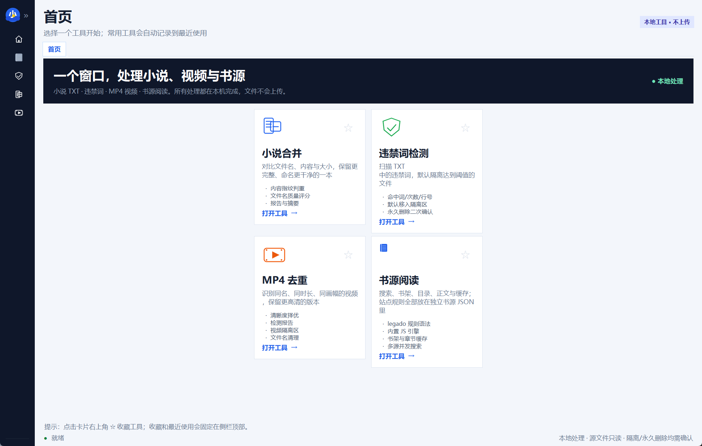
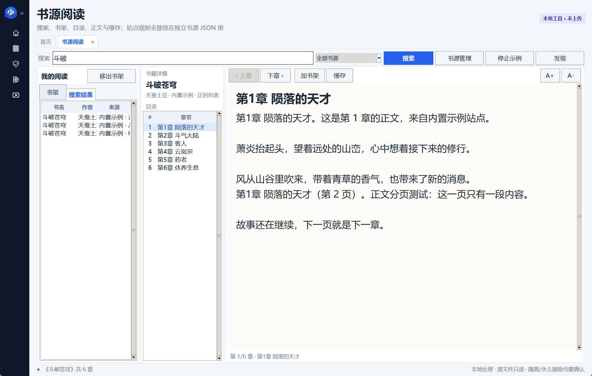
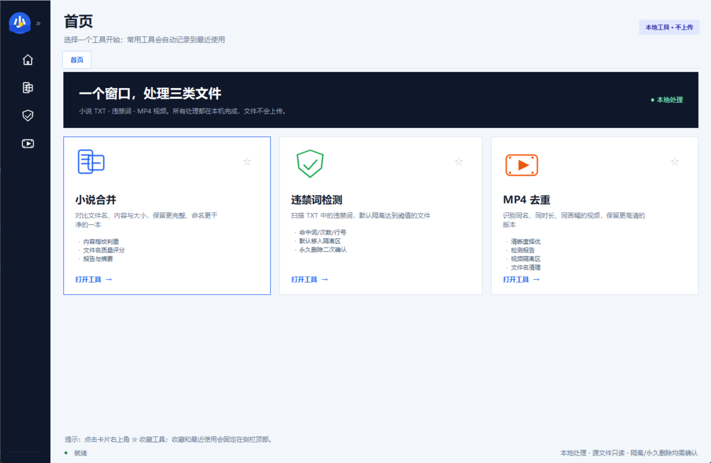
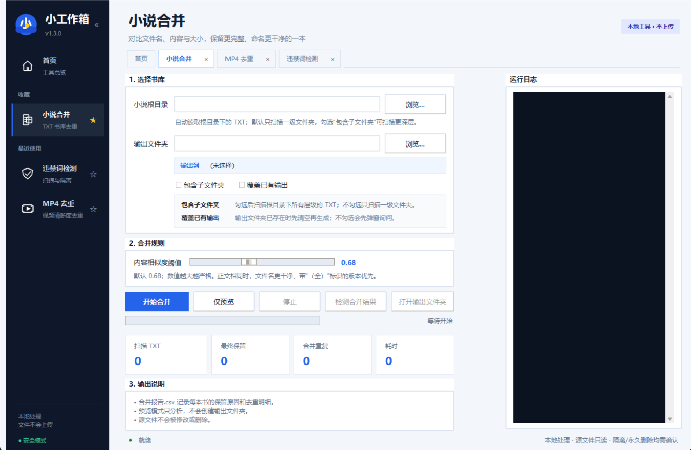
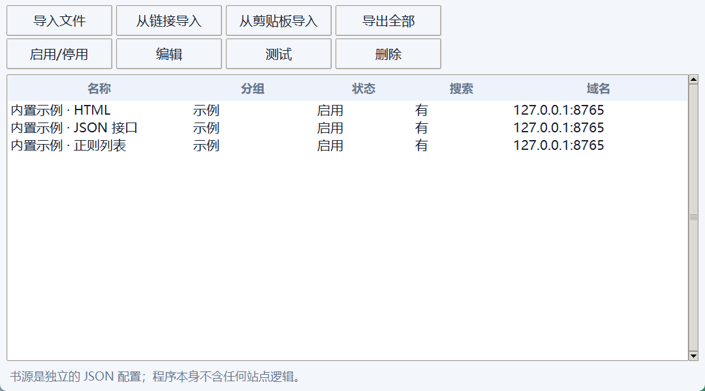

# 小工作箱

一个 Windows 桌面小工具，把四件事放在同一个窗口里：

1. **小说合并**：扫描多个小说文件夹，把内容相同或高度相似、只是文件名/版本不同的 TXT 合并为一本，输出到最终文件夹。
2. **违禁词检测**：扫描合并结果或任意 TXT，按词库列出命中词、次数和行号；命中文件默认移入隔离区，不自动永久删除。
3. **MP4 去重**：扫描视频文件夹，把同名、同时长、同画幅的不同清晰度版本合并，保留分辨率/码率更高的一份；不拼接视频。
4. **书源阅读**：按 legado 小说书源（JSON）搜索、加书架、看目录、读正文、缓存全本；站点规则全部在书源配置里，程序本体只负责 UI、书架、缓存和任务调度。

默认只读处理源文件。只有你明确点击“隔离/永久删除”并二次确认后，工具才会移动或删除命中文件。

## 界面

- 左侧为图标 + 文字导航，点顶部 `«` 可折叠为仅图标；
- 首页是工具卡片网格，点击卡片打开对应工具；
- 工具页以多 Tab 打开，可同时保留小说合并、违禁词检测、MP4 去重、书源阅读的工作状态；
- 每个工具右侧的 `☆` 可收藏，收藏和最近使用会固定显示在侧栏顶部；
- 首次启动不预填文件路径；选择过的路径会保存到 `%APPDATA%\小工作箱\settings.json`，下次自动恢复。
- 违禁词检测页提供 **标准词库 → 现场编辑**，可直接在程序内增删违禁词。









## 安装包

推荐直接运行：

```text
安装包/小工作箱安装包_v1.3.1.exe
```

安装程序会：

- 安装到当前用户的 `%LOCALAPPDATA%\Programs\小工作箱`，不需要管理员权限；
- 创建桌面快捷方式和开始菜单快捷方式；
- 开始菜单中同时提供“卸载小工作箱”；
- 安装完成后可直接启动。

> 安装包目前没有代码签名，Windows 可能显示 SmartScreen 提示。点击“更多信息 → 仍要运行”即可。程序完全在本地运行，不上传文件。
>
> v1.3.1 已改用 NSIS 安装器，不再依赖系统临时目录，避免部分电脑因 Temp 权限异常出现“无法创建目录”的错误。
>
> 安装包 v1.3.1 不包含书源阅读；书源阅读在源码版 v1.4.0 中提供。

## 源码 / 便携启动

如果不使用安装包，双击：

```text
启动小工作箱.bat
```

或在当前目录打开 PowerShell：

```powershell
python novel_toolbox.py
```

这种方式需要：

- Windows 10 / 11
- Python 3.10 或更高版本（安装时勾选 Add Python to PATH）
- 小说合并 / 违禁词 / MP4 去重不需要第三方库；Tkinter 随 Python 提供
- 书源阅读另需 `requirements-book-source.txt`（pythonmonkey、lxml 等），不装不影响其它工具

安装版已经内置 Python 运行时，不需要额外安装 Python。

## 界面说明

### ① 小说合并

1. 选择“小说根目录”；
2. 选择“输出文件夹”，默认是 `根目录/合并结果`；
3. 相似度阈值保持默认 `0.68` 即可；
4. 点“开始合并”。

合并完成后可以直接点：

- **打开输出文件夹**：查看最终书库；
- **检测合并结果**：自动把输出文件夹送入违禁词检测页面并开始检测。

判断“哪一份更好”的规则：

- 先按正文内容哈希判断完全相同；
- 再用句段指纹判断近似重复，要求正文长度接近；
- 正文更完整、解码坏字符更少者优先；
- 正文几乎相同时，文件名更干净者优先：
  - 作者字段、`（全）/完结` 标识加分；
  - 序号前缀、`_d5_t19` 采集器后缀、`副本`、重复标题、首尾空格等扣分；
- 不同卷（如“第一卷/第二卷”）不会因为标题相似而被误合并；
- 同名但内容不同的书会都保留，第二本自动加 `(2)` 后缀。

输出文件夹内容：

```text
合并结果/
├─ 保留的小说.txt
├─ 合并报告.csv     ← 每个文件的保留/合并结果
└─ 合并摘要.txt     ← 扫描数、保留数、耗时
```

### ② 违禁词检测

1. 选择“检测对象”：一个文件夹，或者单个 TXT；
2. 词库：第一次使用为空；点 **标准词库 → 现场编辑** 可直接修改标准词库，保存后立即生效；
3. 标准词库位置：`%APPDATA%\小工作箱\标准违禁词.txt`，每行一个词，`#` 开头为注释；
4. 不选择自定义词库时，检测会自动使用这个标准词库；
5. 选择检测报告保存位置（首次选择后自动记住）；
6. 点“开始检测”。

结果表会显示文件名、违禁词、次数、行号；选中一行可看到完整路径。

处理命中文件：

- **隔离达标文件**（默认）：把达到“删除阈值”的文件移动到根目录下的 `违禁词隔离区_日期时间`，可以手动恢复；不会永久删除。
- **永久删除**：必须勾选“永久删除（不推荐，不进回收站）”，然后连续确认两次。此操作不可恢复。

隔离、永久删除都会追加写入 `删除记录.csv`。

### ③ MP4 去重

1. 选择“视频根目录”和“输出文件夹”；
2. 默认勾选“包含子文件夹”和“完整哈希校验”；
3. 点 **仅预览**：只检测、不复制，但会生成检测报告；
4. 点 **开始去重**：检测并复制保留版本。

判断规则：

- 完全相同：完整 SHA-256 哈希一致，直接判重；
- 不同清晰度：文件名、时长、画幅一致，分辨率/体积不同，视为同一部，保留分辨率最高、码率/体积更大的版本；
- 集数、正片/预告片/花絮冲突时不会合并；
- 没有读到视频元数据时，只按完整哈希判重，宁可少合并，不误删；
- 默认复制到 `视频合并结果`，不拼接视频。

检测报告：

- 每次检测（包括仅预览）都会生成 `视频检测报告.csv` 和 `视频检测报告_摘要.txt`；
- 点 **查看检测报告** 可在程序内查看每个文件的分辨率、时长、大小、保留/重复状态；
- 点 **打开报告** 可打开 CSV。

隔离重复视频：

- 检测完成后，点 **隔离重复视频**，会把每组的非保留版本移入 `视频隔离区_日期时间`；
- 保留版本和唯一视频不会被移动，也不会永久删除，可手动恢复；
- 隔离记录写入 `视频隔离记录.csv`；
- 点 **打开隔离区** 可直接查看。

批量清理 MP4 文件名：

- 点 MP4 页面上的 **批量清理文件名**；
- 默认删除文件名中的“正在播放”四个字，也可以改成其他文字；
- 先点 **扫描预览**，确认旧名和新名，再点 **执行改名**；
- 只改文件名，不改视频内容；
- 新名字冲突时自动加 `(2)`、`(3)`，不会覆盖已有文件；
- 勾选 **同时清理所有带冒号的文件**，可以处理不含“正在播放”但带冒号的 MP4；
- 勾选 **删除文件名末尾 4 位以上数字编号**，可以去掉 `_123456789` 这类尾部编号；
- 改名报告保存为 `MP4改名报告.csv`。

例如：

```text
正在播放 电影.mp4          → 电影.mp4
电影 正在播放.mp4          → 电影.mp4
正在播放电影（1080p）.mp4  → 电影（1080p）.mp4
```

> v1.3.1 会同时去掉中英文冒号，并支持删除文件名末尾 4 位以上数字编号；不会误删标题中间的年份。

输出：

```text
视频合并结果/
├─ 保留的视频.mp4
├─ 视频合并报告.csv
└─ 视频合并摘要.txt

视频检测报告.csv              ← 每次检测都生成
视频检测报告_摘要.txt
视频隔离区_日期时间/          ← 主动隔离后生成
视频隔离记录.csv
```

### ④ 书源阅读

书源阅读把「站点怎么抓、怎么解析」放进独立的 legado 书源 JSON，程序只负责搜索、
书架、目录、正文、缓存和界面。详细设计见 [docs/书源引擎设计.md](docs/书源引擎设计.md)。

**先安装可选依赖**（只影响书源阅读，其它工具仍不需要第三方库）：

```powershell
python -m pip install -r requirements-book-source.txt
```

1. 打开左侧「书源阅读」；
2. 点 **书源管理 → 导入文件 / 从链接导入 / 从剪贴板导入**，选择 legado 书源 JSON
   （数组、单个对象、`{"bookSources":[...]}` 都支持）；
3. 输入关键词，选择「全部书源」或单个书源，点「搜索」；
4. 有 `exploreUrl` 的书源可点 **发现**，选择分类/榜单后再双击结果；
5. 双击搜索结果打开书籍，右侧加载详情与目录；双击目录章节开始阅读；
6. 点 **加书架** 保存目录和进度；下次从书架双击即可继续；
7. 点 **缓存** 把当前书的所有章节正文缓存到本地（按钮会变成「停止缓存」）；
8. 正文右上角 `A-` / `A+` 调字号，设置会记住。

没有现成书源时，点 **示例站点**：程序会在本机启动一个演示网站（127.0.0.1:8765），
并导入 HTML、JSON、正则三个示例书源，可以完整走一遍搜索、目录、分页正文和缓存。
示例站点只在本机运行，不访问外网。

> 已用源仓库中带 `jsLib`、`exploreUrl`、POST 搜索、章节 token 解密的真实书源验证：
> 搜索、详情、目录（538 章）、正文解密与 HTML 清洗均可正常完成。



书源管理还支持：

- **编辑**：直接改 JSON，保存前校验；
- **测试**：输入关键词，显示该源返回的书名和数量；
- **启用/停用**、**删除**、**导出全部**。

书源规则支持 legado 小说书源的主要语法：

- 默认规则：`class.book-list@tag.li@tag.a@text`、`id.content@html`；
- `@CSS:`、`@XPath:`、`@Json:`、`@js:`、`:正则`（列表规则，字段用 `$1`）；
- `&&` 连接、`||` 第一个非空、`%%` 按索引交错、`##正则##替换`；
- `@put:{key: 规则}` / `@get:{key}` / `{{key}}` / `{{page}}`；
- `bookList`、`chapterList` 的 `-` 前缀反转；
- URL 的 `<1,2,3>` 页码选择与 `,{...}` 请求选项（method/body/headers/retry）；
- 书源自带的 `jsLib` 公共函数、`exploreUrl` 的 `@js:` 分类/榜单生成、`concurrentRate` 限速；
- `source.get/put/getVariable`、`cookie.*`、`cache.*` 等 legado JS 常用对象；
- 书源规则里的旧域名/镜像域名连接失败时，自动改用书源自身域名重试一次；
- 部分站点会 reset 普通 GET，自动改用无 body 的 POST 重试。

存储位置：

```text
%APPDATA%\小工作箱\书源\
├── sources.json      书源
├── bookshelf.json    书架、目录、进度
├── cache\            章节正文缓存
└── settings.json     字号等阅读设置
```

> 书源里的 JS 是可执行配置，和 legado 一样只应导入可信来源。
>
> 当前安装包 v1.3.1 尚未包含书源阅读；书源阅读在源码版 v1.4.0 中提供。

## 文件说明

| 文件 | 用途 |
|---|---|
| `安装包/小工作箱安装包_v1.3.1.exe` | Windows 安装包（推荐，内置运行时） |
| `安装包/SHA256.txt` | 安装包校验值 |
| `novel_toolbox.py` | 桌面主程序源码 |
| `启动小工作箱.bat` | 源码版双击启动（无控制台窗口） |
| `app.ico` | 程序图标 |
| `assets/` | 侧栏图标和 Logo |
| `book_source/` | 书源引擎：网络、JS、规则、解析、书架、缓存、任务队列、书源阅读页 |
| `书源示例/` | 三个可直接导入的示例书源（HTML / JSON / 正则） |
| `requirements-book-source.txt` | 书源阅读的可选依赖 |
| `test_book_source.py` | 书源引擎端到端测试 |
| `docs/书源引擎设计.md` | 分层、规则语法、数据格式与边界说明 |
| `novel_merger.py` | 小说合并去重核心，也可单独用命令行 |
| `word_checker.py` | 违禁词检测核心 |
| `video_merger.py` | MP4 去重核心（内置 MP4 元数据解析，无需 ffmpeg） |
| `file_renamer.py` | MP4 文件名批量清理核心 |
| `违禁词.txt` | 默认违禁词库 |
| `标准违禁词.txt` | 标准词库模板；首次运行复制到用户目录，可在程序内现场编辑 |
| `合并结果/` | 已生成的小说最终书库 |
| `视频合并结果/` | MP4 去重输出（运行后生成） |
| `视频检测报告.csv` | MP4 检测/去重报告（检测后生成） |
| `视频检测报告_摘要.txt` | MP4 检测摘要 |
| `视频隔离区_日期时间/` | 主动隔离的重复视频 |
| `视频隔离记录.csv` | MP4 隔离记录 |
| `MP4改名报告.csv` | MP4 文件名清理记录 |
| `合并报告.csv` | 小说合并明细 |
| `检测结果.csv` | 违禁词检测报告（运行检测后生成） |
| `删除记录.csv` | 隔离/删除日志（处理后生成） |
| `运行合并.bat` | 只运行小说合并程序的旧入口 |

## 命令行合并（可选）

不想开界面时，仍可直接运行：

```powershell
# 预览，不写文件
python novel_merger.py --dry-run

# 正式合并
python novel_merger.py --root . --output 合并结果

# 覆盖已有输出
python novel_merger.py --overwrite

# 递归扫描来源文件夹
python novel_merger.py --recursive
```

常用参数：

| 参数 | 说明 |
|---|---|
| `root` / `--root` | 小说根目录，默认当前目录 |
| `-o, --output` | 输出文件夹，默认 `合并结果` |
| `--source` | 只扫描指定子文件夹，可重复使用 |
| `--recursive` | 递归扫描来源文件夹 |
| `--overwrite` | 清空已存在的输出文件夹再生成 |
| `--dry-run` | 只分析预览，不写任何文件 |
| `--threshold` | 内容相似度阈值，默认 `0.68` |
| `--size-ratio` | 允许比较的最小正文长度比，默认 `0.72` |
| `--verbose` | 打印每个重复组的取舍详情 |

## 安全说明

- 合并只读原文件，使用 `shutil.copy2` 复制到新文件夹；
- 默认拒绝覆盖已有输出；勾选“覆盖已有输出”或在命令行加 `--overwrite` 才会重建；
- 输出路径不能是根目录、根目录上级、来源文件夹本身或来源文件夹内部；
- 违禁词检测默认不删除，只隔离；
- 永久删除需要勾选选项并两次确认；
- MP4 去重默认只复制，不拼接视频；只有主动点击“隔离重复视频”并确认后，重复文件才会被移动到隔离区；
- 所有隔离/删除记录都会写入 `删除记录.csv`。
- 书源里的 JS 属于可执行配置，只应导入可信来源；示例站点只监听 `127.0.0.1`。

## 运行测试

```powershell
python -m unittest -v test_novel_merger.py test_word_checker.py test_video_merger.py test_file_renamer.py test_book_source.py
```

测试覆盖：

- 前缀文件名、采集器后缀、完结标识；
- 近似重复、不同卷不误合并、长短版本取舍；
- UTF-8 / GB18030 编码、同名不同书、预览模式、输出路径保护；
- 违禁词大小写、长词优先、报告排除自身、行号统计、隔离与永久删除；
- MP4 元数据解析、完全相同去重、不同清晰度择优、不同集数不合并、无元数据时只按哈希判重；
- MP4 预览检测报告、重复视频隔离、隔离日志；
- MP4 文件名删除指定文字、重名冲突处理、改名报告；
- 书源默认规则、CSS、XPath、JSONPath、正则列表、`&&/||/##/@put/@get`、
  `@js:` + `java.ajax`、GBK、gzip、目录分页、正文分页、书架与章节缓存。
